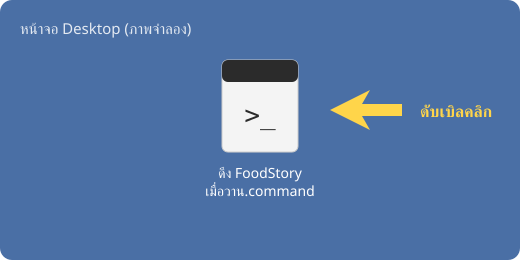
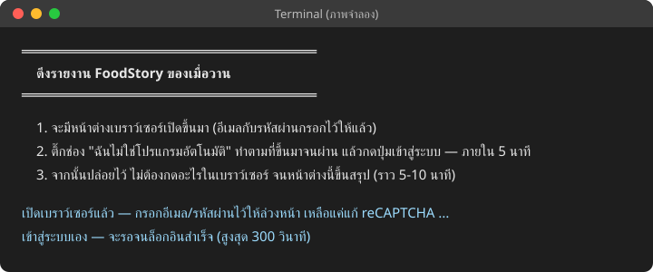
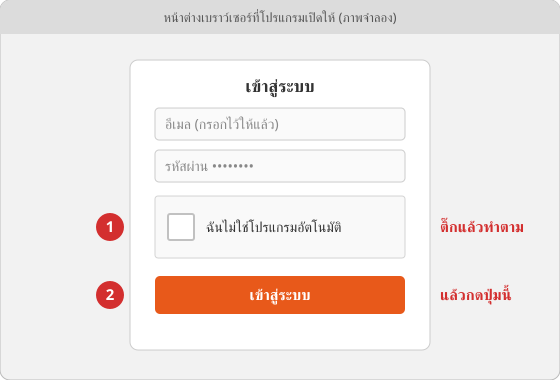
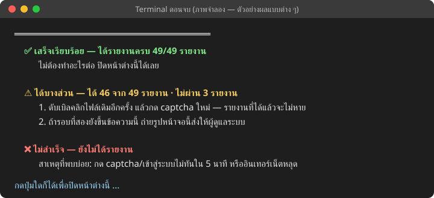

# คู่มือพนักงาน: ดึงรายงาน FoodStory ของเมื่อวาน

> 🔄 **ตอนนี้เครื่อง Ubuntu ดึง FoodStory ให้เองทุกวัน** 12:00 (ลองซ้ำ 15:00 / 18:00) และแก้ captcha เอง — **ปกติไม่ต้องกดอะไรแล้ว**
> ใช้คู่มือนี้เป็น**ทางสำรอง**เท่านั้น: กดเมื่อ Discord แจ้งว่า FoodStory รอบอัตโนมัติล้ม (เช่น "FoodStory login failed") ·
> **อย่ากดช่วง 12:00–12:45 / 15:00 / 18:00** (รอบอัตโนมัติกำลังรัน — กดซ้อนกันจะ login ชนกัน)

ใช้เวลากดจริงไม่ถึง 1 นาที ที่เหลือโปรแกรมทำเองราว 5 นาที (ถ้ามีวันที่ขาดค้างอยู่ วันละราว 3 นาทีเพิ่ม)

> รูปในคู่มือนี้เป็นภาพจำลอง หน้าจอจริงอาจต่างเล็กน้อย

## เมื่อ Discord แจ้งว่ารอบอัตโนมัติล้ม (พนักงาน)

**ทำได้ทั้งวัน ยกเว้นช่วงที่รอบอัตโนมัติรัน (12:00–12:45 / 15:00 / 18:00)** — โปรแกรมดึงยอดของ **เมื่อวาน** (วันที่ปิดยอดแล้ว) ไม่ว่าจะกดตอนเช้าหรือตอนเย็น · ถ้ามีวันที่ยังไม่ได้กด
โปรแกรมดึงวันนั้นให้ด้วยในครั้งเดียวกัน (ครั้งละไม่เกิน 3 วัน) · และเก็บ snapshot สต็อก/ยอดสะสม ณ ตอนที่กด

ถ้ารายงานได้ครบแล้ว (เช่น กดไปแล้ววันนี้) หน้าต่างจะขึ้น ✅ **ไม่มีงานค้าง** โดยไม่เปิดเบราว์เซอร์ และไม่ต้องกด captcha

### 1. ดับเบิลคลิกไฟล์บน Desktop



หน้าต่างสีดำ (Terminal) จะเปิดขึ้นมาพร้อมคำแนะนำ — ไม่ต้องพิมพ์อะไร



### 2. ยืนยันว่าไม่ใช่โปรแกรมอัตโนมัติ แล้วเข้าสู่ระบบ — ภายใน 5 นาที

หน้าต่างเบราว์เซอร์จะเปิดขึ้นมาที่หน้าเข้าสู่ระบบ FoodStory **อีเมลกับรหัสผ่านกรอกไว้ให้แล้ว**

> เครื่องที่ตั้งคีย์ 2captcha ไว้ (เครื่อง Ubuntu) โปรแกรม**แก้ captcha และกดเข้าสู่ระบบให้เอง** ภายในราว 1–2 นาที — ไม่ต้องทำข้อ 1–2
> แค่รอแล้วไปข้อ 3 · ถ้าผ่านไป 5 นาทียังค้างที่หน้าเข้าสู่ระบบ ให้ถ่ายรูปหน้าจอส่งผู้ดูแลระบบ

1. ติ๊กช่อง **"ฉันไม่ใช่โปรแกรมอัตโนมัติ"** (บางครั้งขึ้นเป็น "I'm not a robot") ถ้ามีรูปให้เลือก ทำตามจนผ่าน
2. กดปุ่ม **เข้าสู่ระบบ**



### 3. ปล่อยไว้จนหน้าต่าง Terminal ขึ้นสรุป

หลังเข้าสู่ระบบ โปรแกรมจะเปิดหน้ารายงานทีละหน้าเอง **ไม่ต้องกดอะไรในเบราว์เซอร์** และอย่าปิดหน้าต่างใดระหว่างนี้
(ใช้คอมพิวเตอร์ทำงานอื่นต่อได้ แต่อย่าคลิกในหน้าต่างเบราว์เซอร์นั้น)

### 4. อ่านสรุป แล้วกดปุ่มใดก็ได้เพื่อปิดหน้าต่าง



| ขึ้นว่า | ต้องทำอะไร |
|---|---|
| ✅ **เสร็จเรียบร้อย** | ไม่ต้องทำอะไรต่อ ปิดหน้าต่างได้เลย · บรรทัดใต้นั้นบอกว่าได้ข้อมูลวันไหน และถ่าย snapshot กี่รายงาน |
| ✅ **ไม่มีงานค้าง** | ได้ครบแล้วตั้งแต่ครั้งก่อน ไม่ต้องกด captcha ปิดหน้าต่างได้เลย |
| ⚠️ **ได้บางส่วน** | ดับเบิลคลิกไฟล์เดิมอีกครั้ง แล้วกด captcha ใหม่ — รายงานที่ได้แล้วจะไม่หาย · ถ้ารอบที่สองยังขึ้นแบบเดิม ถ่ายรูปหน้าจอส่งให้ผู้ดูแลระบบ |
| ❌ **ไม่สำเร็จ** | ถ้าขึ้นว่า "ยังไม่ได้รายงาน" ส่วนใหญ่เพราะกดเข้าสู่ระบบไม่ทันใน 5 นาที หรืออินเทอร์เน็ตหลุด — ดับเบิลคลิกใหม่อีกครั้ง ถ้ายังไม่ได้ถ่ายรูปหน้าจอส่งให้ผู้ดูแลระบบ · ถ้าขึ้นว่า "เข้าสู่ระบบได้ แต่ไม่ได้รายงานเลย" ถ่ายรูปหน้าจอส่งให้ผู้ดูแลระบบเลย |

## คำถามที่พบบ่อย

- **ลืมกดไปวันหนึ่ง เป็นอะไรไหม** — ยอดขายไม่หาย การกดครั้งถัดไปดึงวันที่ขาดให้เอง (ครั้งละไม่เกิน 3 วัน — ขาดมากกว่านั้น หน้าต่างจะขึ้น ⚠️ "ยังขาดอีก N วัน" ให้ดับเบิลคลิกอีกครั้งเพื่อเติมต่อ) ·
  แต่ snapshot สต็อก/ยอดสะสม ณ วันที่ไม่ได้กด เก็บย้อนหลังไม่ได้ · ไม่ได้กดมา 2 วัน ผู้ดูแลระบบจะได้แจ้งเตือน
- **กดซ้ำในวันเดียวกันได้ไหม** — ได้ ทำเฉพาะที่ยังไม่ได้ ถ้าได้ครบแล้วจะขึ้น "ไม่มีงานค้าง" โดยไม่ต้องกด captcha · รายงานที่ได้แล้วไม่หาย
- **เผลอดับเบิลคลิกสองครั้ง** — หน้าต่างที่สองจะบอกว่า "รันอยู่แล้ว" ให้ปิดหน้าต่างนั้นแล้วรอหน้าต่างแรกจนจบ
- **เผลอปิดหน้าต่างระหว่างทำงาน** — ดับเบิลคลิกใหม่ได้เลย
- **ขึ้นข้อความเกี่ยวกับ `.env`, Node.js หรือ `npm install`** — เป็นเรื่องการติดตั้ง ถ่ายรูปหน้าจอส่งให้ผู้ดูแลระบบ
- 🔴 **ไฟล์ที่ได้มีข้อมูลลูกค้าและยอดขาย** — ห้ามส่งต่อออกนอกร้าน ห้ามอัปโหลดขึ้นที่อื่น

---

## สำหรับผู้ดูแลระบบ

### ติดตั้งครั้งแรก (ทำครั้งเดียวต่อเครื่อง)

บน **Ubuntu** ใช้ตัวติดตั้งคำสั่งเดียวแทนขั้นด้านล่างทั้งหมด — ดู [คู่มือผู้ดูแลระบบ Ubuntu](UBUNTU-ADMIN-GUIDE.md) · ขั้นด้านล่างสำหรับ macOS
หรือติดตั้งเอง

ไม่ผูกกับเครื่องใดเครื่องหนึ่ง — ใช้ได้ทั้ง **macOS** และ **Ubuntu Desktop** (ต้องมีจอและมีคนกด captcha) · ตอนนี้ (2026-10) ติดตั้งบน Mac
ของผู้ดูแลระบบ (เครื่อง dev/test) และกำลังย้ายไปเครื่อง Ubuntu

1. ติดตั้ง Node.js **22.18 ขึ้นไป** — ไฟล์ดับเบิลคลิกหา node เองทั้ง `PATH`, nvm default, `/opt/homebrew/bin`, `/usr/local/bin` และ
   `/usr/bin` ไม่ต้องตั้ง `PATH`
   - macOS: nvm, Homebrew หรือตัวติดตั้งจาก nodejs.org
   - Ubuntu: nvm หรือ NodeSource (`apt` ของ Ubuntu เองมักเป็นรุ่นเก่ากว่า 22.18 — เช็คด้วย `node --version`)
2. ในโฟลเดอร์ `exporter/`: `npm install` แล้วติดตั้งเบราว์เซอร์
   - macOS: `npx playwright install chromium`
   - Ubuntu: `npx playwright install --with-deps chromium` (ติดตั้ง library ของระบบด้วย — จะถามรหัส sudo)
3. สร้าง `exporter/.env` จาก `.env.example` ใส่ `FOODSTORY_*` (อีเมล/รหัสผ่าน/สาขา) — ไฟล์นี้ห้าม commit
4. วางไฟล์บน Desktop — รันในบัญชีของคนที่จะใช้เครื่อง **ห้ามใส่ `sudo`** (ไอคอนจะไปอยู่บน Desktop ของบัญชีที่รัน):

   ```bash
   bash exporter/launchers/install-desktop-launcher.sh
   ```

   - macOS: ได้ symlink ชื่อ "Exporter - FoodStory Daily" บน Desktop (อย่าก๊อปไฟล์ .command เอง — ก๊อปแล้วจะหาโฟลเดอร์ exporter ไม่เจอ)
   - Ubuntu: ได้ไอคอน "Exporter - FoodStory Daily" บน Desktop และในเมนูแอป (ค้นชื่อได้) · ถ้าดับเบิลคลิกแล้วขึ้นว่าไม่ไว้ใจ (untrusted)
     ให้คลิกขวาที่ไอคอน → **Allow Launching** ครั้งเดียว
   - รันซ้ำได้ · ถ้ามีไฟล์ชื่อเดียวกันที่ไม่ได้สร้างจากคำสั่งนี้ จะไม่เขียนทับ (ให้ดูแล้วลบเอง)
5. ลองดับเบิลคลิกเองหนึ่งรอบ — macOS ครั้งแรกอาจถามสิทธิ์ให้ Terminal ให้กดอนุญาต · Ubuntu จะเปิดหน้าต่าง Terminal ให้เอง

### ไฟล์ไปอยู่ที่ไหน

`exporter/data/foodstory/daily/<YYYY-MM>/<วันของข้อมูล>/` — รายงานตามวันชื่อ `<วันของข้อมูล>__<รายงาน>.xlsx` (เช่น `2026-10-13__salebybill.xlsx`) ·
รายงาน snapshot 7 ตัวอยู่ในโฟลเดอร์ของวันที่กด ชื่อ `<เวลาที่ถ่าย>__<รายงาน>.xlsx` (เช่น `20261014T175436+0700__current_stock.xlsx`) ·
`exporter/data/foodstory/daily/latest` ชี้โฟลเดอร์ของวันนี้ · ไฟล์ดิบตามที่ FoodStory ให้มา · ทุกโฟลเดอร์มี `_manifest.json` (ไฟล์ไหน ครอบวันไหน
กี่แถว sha256) และ `_summary.txt` (สรุปภาษาไทย) · รายละเอียด: [`exporter/README.md`](../exporter/README.md) และ ADR-0005/0006/0008/0009

### เมื่อพนักงานส่งรูปหน้าจอมา

- ⚠️/❌ ซ้ำสองรอบ: ดู `_summary.txt` ของวันนั้นว่ารายงานไหนล้มด้วยข้อความอะไร แล้วดูคู่มือ exporter
  (`.claude/skills/exporter/SKILL.md` ส่วน FoodStory)
- ข้อความเรื่อง `.env` / Node.js / `npm install`: ทำขั้นติดตั้งด้านบนให้ครบ
- ตัวไฟล์ดับเบิลคลิกคือ `exporter/launchers/foodstory-daily.command` — รัน
  `node src/index.ts export --site foodstory --report all --daily --headful` ในโฟลเดอร์ exporter (login ครั้งเดียว ตั้งวันที่ทีละวันของข้อมูล:
  เมื่อวาน + วันที่ขาดตั้งแต่วันเริ่มใช้งาน ครั้งละไม่เกิน 3 วัน + รายงาน snapshot ของวันนี้) แล้วสรุปเป็นภาษาไทยจาก `_run.json` ทุกโฟลเดอร์ที่รอบนี้เขียน
  (รอบนี้ล้มบางใบแต่ไฟล์จากรอบก่อนยังอยู่ ถือว่าได้แล้ว) · ไม่มีงาน = จบโดยไม่เปิดเบราว์เซอร์
- ดูภาพรวมทุกวัน: `node src/index.ts status` (ส่วน "FoodStory รายวัน") — บอกว่าไม่ได้กดมากี่วัน วันไหนยังไม่ได้ดึง รายงานไหนว่าง/ล้ม
- ล็อกกันรันซ้อนอยู่ที่ `data/foodstory/.daily-launcher.pid` (ล็อกค้างจาก process ที่ตายแล้วถูกยึดต่อเอง) — ไม่กันรอบที่ผู้ดูแลรันเอง
  ด้วย `exporter export ...` อย่ารันพร้อมกับพนักงาน
